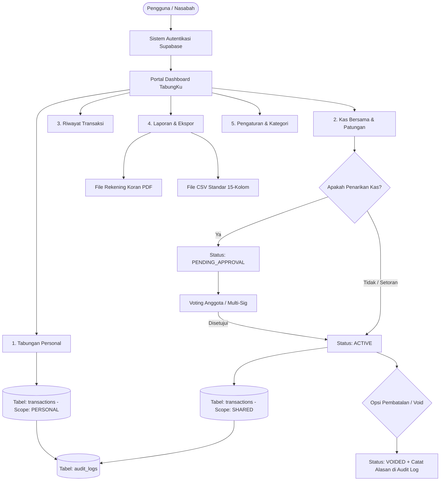
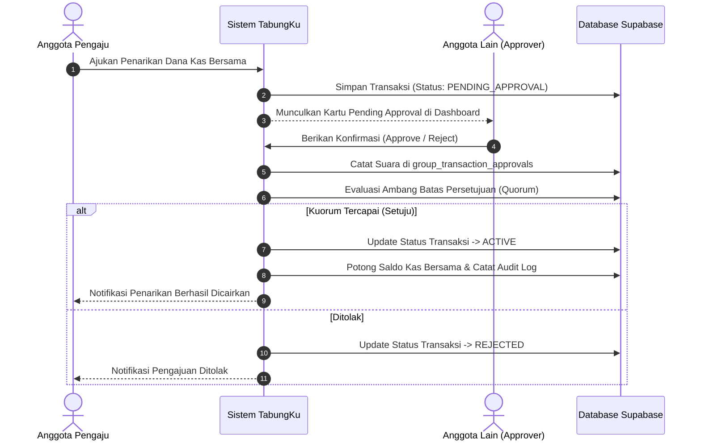
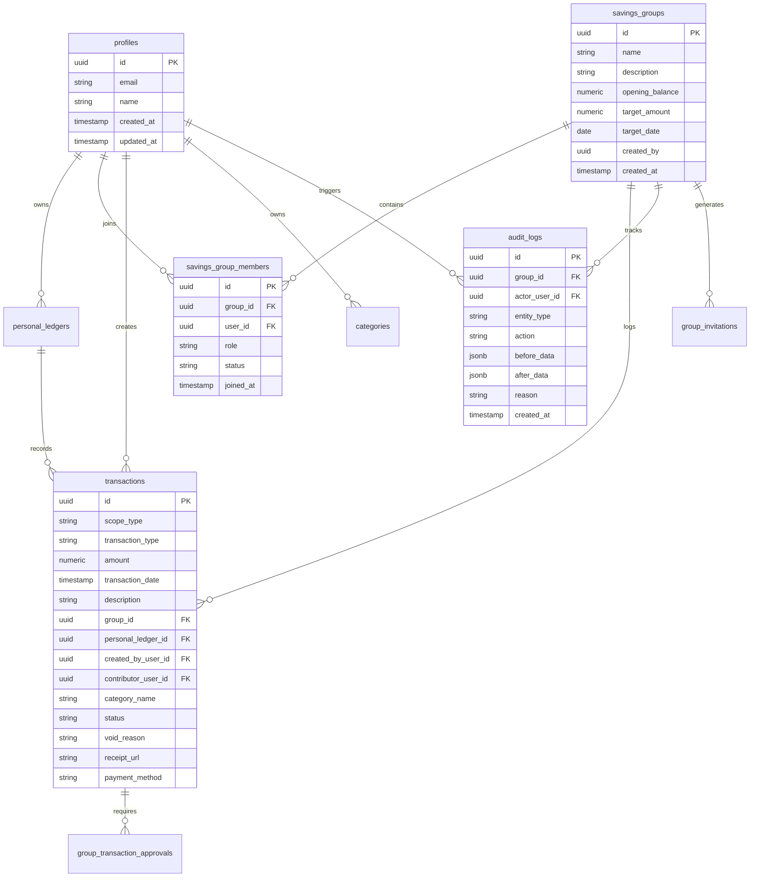

# Product Requirement Document (PRD) — TabungKu v2.0
**Platform Pengelolaan Tabungan Personal & Kas Bersama Terverifikasi**

---

## 1. Executive Summary & Ringkasan Dokumen
Dokumen ini merangkum seluruh spesifikasi fungsional, aturan bisnis, arsitektur data, alur kerja (*business processes*), serta standar antarmuka yang **telah berhasil diimplementasikan dan berjalan aktif (*production-ready*)** pada aplikasi **TabungKu**.

PRD ini berfungsi sebagai acuan resmi bagi *stakeholder*, auditor sistem, pengembang, dan pemilik produk untuk mereview, memvalidasi kepatuhan bisnis, dan mengawal iterasi selanjutnya.

---

## 2. Latar Belakang & Pernyataan Masalah
Pengelolaan keuangan personal sering kali tercampur dengan dana kelompok (seperti kas arisan, patungan liburan, dana darurat keluarga, atau kas organisasi). Praktik manual menggunakan spreadsheet atau aplikasi perpesanan WhatsApp menimbulkan berbagai risiko fatal:
1. **Pencampuran Portofolio (*Portfolio Commingling*)**: Rekening pribadi bercampur aduk dengan dana titipan bersama.
2. **Ketiadaan Kontrol Otorisasi Kolektif**: Pengeluaran dana bersama sering dilakukan sepihak tanpa konfirmasi atau izin anggota lain.
3. **Pencatatan Rentan Manipulasi**: Transaksi salah input dihapus diam-diam tanpa riwayat jejak audit (*audit trail*).
4. **Kesulitan Rekonsiliasi**: Ketiadaan laporan berkala formal standar perbankan (Rekening Koran / CSV terstruktur).

---

## 3. Pilar Arsitektur Bisnis & Prinsip Desain
TabungKu dibangun dengan 4 pilar arsitektur utama:
1. **Strict Portfolio Isolation**: Pemisahan tegas antara saldo personal (`personal_ledgers`) dan saldo kas kelompok (`savings_groups`).
2. **Multi-Signature Governance**: Mekanisme voting/persetujuan berjenjang sebelum transaksi penarikan kas bersama dieksekusi.
3. **Immutable Audit Trail & Void Integrity**: Transaksi tidak dihapus secara fisik (*hard delete*), melainkan dibatalkan melalui status `VOIDED` dengan alasan yang dicatat permanen.
4. **Bank-Grade Export & Reporting**: Ekspor Rekening Koran PDF resmi dan tabel CSV berstandar 15-kolom perbankan internasional.

---

## 4. Analisis Persona & Peran Pengguna (*User Roles*)

| Peran (*Role*) | Lingkup Otoritas | Tanggung Jawab & Hak Akses |
| :--- | :--- | :--- |
| **Pengguna Individu** | Portofolio Personal | Mengelola pemasukan & pengeluaran pribadi, membuat kategori mandiri, mengatur privasi masker saldo, mengunduh laporan mutasi pribadi. |
| **Group Owner (Pembuat Kas)** | Grup Kas Bersama | Membuat grup, menentukan target nominal & batas waktu, mengundang anggota via token invite, menyetujui penarikan, mengatur pembubaran grup. |
| **Group Member (Anggota Kas)** | Grup Kas Bersama | Menyetor dana kontribusi, mengajukan penarikan dana bersama, memberikan voting persetujuan (*approval/rejection*), melihat audit log grup. |
| **System Administrator** | Platform & Database | Mengelola skema PostgreSQL, memantau integritas Row-Level Security (RLS), bypass rate-limit email autentikasi, mengelola seed data. |

---

## 5. Rincian Modul & Alur Bisnis yang Berjalan

### 5.1. Modul Autentikasi & Registrasi Cepat
- **URL**: `/login`, `/register`, `/auth/logout`
- **Fitur & Alur Bisnis**:
  - Pendaftaran mandiri via Server Action (`registerAction`) dengan bypass email rate limit menggunakan `email_confirm: true` dari Admin API.
  - Akun langsung aktif seketika tanpa tertahan limitasi kuota email.
  - Sesi otomatis terbuat dan langsung diarahkan ke `/dashboard`.
  - Halaman login bersih tanpa ketergantungan OAuth Google eksternal, mendukung input email & kata sandi dengan toggle show/hide.
  - Header halaman depan dan login bersifat responsif adaptif terhadap status autentikasi: saat pengguna sudah login, tombol *Masuk/Daftar* otomatis berubah menjadi tombol **Buka Dashboard**.

---

### 5.2. Modul Tabungan Personal (Buku Kas Mandiri)
- **URL**: `/dashboard/personal`
- **Fitur & Alur Bisnis**:
  - **Saldo Bersih**: `Total Pemasukan (ACTIVE) - Total Pengeluaran (ACTIVE) + Saldo Awal`.
  - **Pencatatan Transaksi**:
    - **Pemasukan (`INCOME`)**: Gaji, bonus, investasi, penjualan, hadiah, dsb.
    - **Pengeluaran (`EXPENSE`)**: Belanja, transportasi, makanan, utilitas, kesehatan, dsb.
  - **Manajemen Kategori Kustom**: Pengguna dapat menambah kategori baru khusus kebutuhan personalnya.
  - **Fitur Privasi (Mode Sensor)**: Dukungan *Privacy Masking* untuk menyembunyikan nominal saldo di ruang publik.
  - **Filter Waktu & Kategori**: Filter instan berdasarkan bulan aktif, rentang tanggal kustom, dan jenis kategori.

---

### 5.3. Modul Tabungan Bersama & Multi-Signature Governance
- **URL**: `/dashboard/shared`, `/dashboard/shared/new`, `/invite/[token]`
- **Fitur & Alur Bisnis**:
  - **Pembuatan Grup**: Pemilik menentukan Nama Grup, Deskripsi, Saldo Awal, Target Nominal, Target Tanggal Jatuh Tempo, dan Ambang Batas Persetujuan (*Approval Quorum*).
  - **Sistem Undangan Anggota**:
    - Pembuatan tautan undangan berbasis token unik `/invite/[token]`.
    - Calon anggota yang membuka tautan dapat langsung bergabung ke grup kas.
  - **Kontribusi / Setoran (`CONTRIBUTION`)**:
    - Setiap anggota dapat mencatatkan setoran ke dalam kas bersama.
    - Menghitung persentase progres ketercapaian target grup secara real-time.
  - **Pengajuan Penarikan Kas Bersama**:
    - Penarikan dana bersama **tidak langsung memotong saldo kas**.
    - Transaksi berstatus `PENDING_APPROVAL`.
    - Kartu notifikasi persetujuan muncul pada dashboard anggota yang berwenang.
  - **Multi-Signature Approval Workflow**:
    - Anggota dapat memilih **Setujui (*Approve*)** atau **Tolak (*Reject*)**.
    - Jika kuorum persetujuan tercapai (misal: 2 dari 3 anggota), status berubah menjadi `ACTIVE` dan saldo grup resmi terpotong.
    - Jika ditolak, status berubah menjadi `REJECTED` dan saldo tidak bergerak.

---

### 5.4. Modul Riwayat Transaksi & Pembatalan (Void Transaction)
- **URL**: `/dashboard/transactions`, `/dashboard/transactions/new`
- **Fitur & Alur Bisnis**:
  - **Tampilan Terpadu Multi-Scope**: Tab filter `Semua Transaksi`, `Tabungan Pribadi`, `Kas Bersama`, dan `Menunggu Persetujuan`.
  - **Aturan Pembatalan Transaksi (*Void Business Rule*)**:
    - Transaksi yang sudah masuk tidak boleh di-*hard delete* dari database demi integritas akuntansi.
    - Tombol **Batalkan (Void)** membuka modal konfirmasi wajib isi alasan pembatalan (*mandatory void reason*).
    - Status transaksi diperbarui menjadi `VOIDED`.
    - Saldo kas otomatis dikembalikan (*recalculated*) seolah transaksi tersebut tidak ada.
    - Riwayat pembatalan, aktor pengubah, dan waktu kejadian dicatat ke tabel `audit_logs`.
  - **Penyimpanan Bukti Nota/Struk Digital**: Opsi unggah dan pratinjau bukti nota (*receipt viewer*) langsung dari tabel transaksi.

---

### 5.5. Modul Laporan & Ekspor Berkas Perbankan
- **URL**: `/dashboard/reports`
- **Fitur & Alur Bisnis**:
  - **1. Ekspor Rekening Koran PDF (`ExportPdfStatementButton`)**:
    - Dokumen berstandar perbankan formal lengkap dengan *header*, nomor dokumen unik, periode cut-off, ringkasan saldo awal, mutasi kredit/debit, saldo akhir, dan tabel mutasi lengkap.
    - Mendukung cetak langsung atau *Save as PDF* dengan CSS `@media print` terisolasi rapi.
  - **2. Ekspor File CSV Standar 15-Kolom (`ExportCsvButton`)**:
    - Dilengkapi deklarasi `sep=,` di baris pertama dan *UTF-8 Byte Order Mark (BOM)* `\uFEFF` sehingga langsung rapi saat dibuka di Microsoft Excel tanpa masalah kolom berantakan.
    - Struktur 15 Kolom Resmi:
      `No, ID Transaksi, Tanggal, Jam, Ruang Lingkup, Nama Grup, Jenis Mutasi, Aliran Dana, Kategori, Nominal (IDR), Status Transaksi, Alasan Void, Dicatat Oleh, Anggota Kontributor, Keterangan`.

---

## 6. Spesifikasi Skema Database PostgreSQL

---

## 7. Keamanan & Kepatuhan (*Security & Compliance*)
1. **Row-Level Security (RLS)**:
   - Setiap baris transaksi pribadi diisolasi penuh: *User A* tidak dapat membaca baris *User B*.
   - Transaksi kas bersama hanya dapat dibaca oleh pengguna yang terdaftar di `savings_group_members` dengan status `ACTIVE`.
2. **Sanitisasi & Anti-Injection**:
   - Seluruh mutasi divalidasi tipe data numeriknya sebelum dieksekusi.
   - Menggunakan Supabase parameterized queries & Postgres constraint triggers.
3. **Penyensoran Privasi di Sisi Klien**:
   - Fitur sensor angka (`MaskableText`) menggunakan enkapsulasi React Context, memastikan saldo tidak tertangkap kamera saat berada di tempat umum.

---

## 8. Ringkasan Status Rilis Fitur (*Feature Delivery Matrix*)

| ID Fitur | Modul Sistem | Status Implementasi | Verifikasi Teknis |
| :---: | :--- | :---: | :--- |
| **F-01** | Landing Page Editorial Catetrek | ✅ Selesai | Responsif, Dark/Light mode adaptif, glassmorphic header |
| **F-02** | Autentikasi Mandiri & Auto-Confirm | ✅ Selesai | Bypass rate limit email Supabase, auto login session |
| **F-03** | Isolasi Buku Kas Personal | ✅ Selesai | Form modal pemasukan/pengeluaran, kategori kustom |
| **F-04** | Grup Kas Bersama & Progres Bar | ✅ Selesai | Perhitungan persentase target, status siklus bulanan |
| **F-05** | Multi-Signature Approval Workflow | ✅ Selesai | Status `PENDING_APPROVAL`, kartu konfirmasi persetujuan |
| **F-06** | Pembatalan Transaksi (Void) & Audit Log | ✅ Selesai | Status `VOIDED`, pencatatan alasan, audit_logs sinkron |
| **F-07** | Ekspor Rekening Koran PDF | ✅ Selesai | Format resmi cetak perbankan |
| **F-08** | Ekspor Laporan CSV 15-Kolom | ✅ Selesai | Header `sep=,`, UTF-8 BOM, kompatibel Microsoft Excel |
| **F-09** | Navigasi Bawah Mobile (*Safe Area*) | ✅ Selesai | `max(0.5rem, safe-area-inset-bottom)`, posisi rapat bawah |
| **F-10** | Toggle Tema Gelap/Terang Kompak | ✅ Selesai | Tombol ikon melingkar serasi di desktop & mobile |

---
*Dokumen ini diperbarui secara otomatis sesuai dengan kode sumber aktif di cabang `main` repository TabungKu.*

